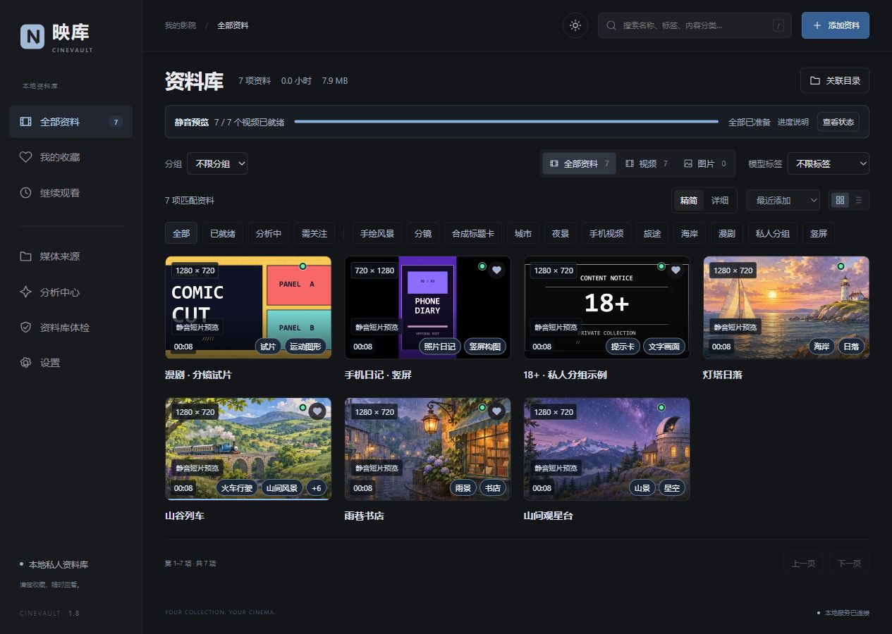
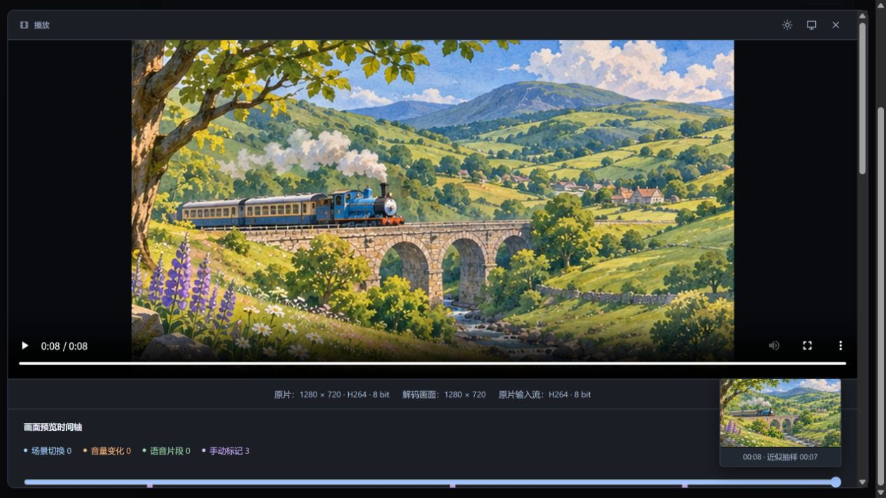
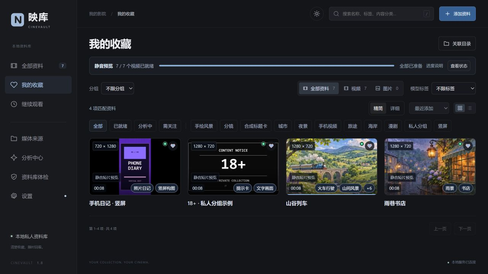
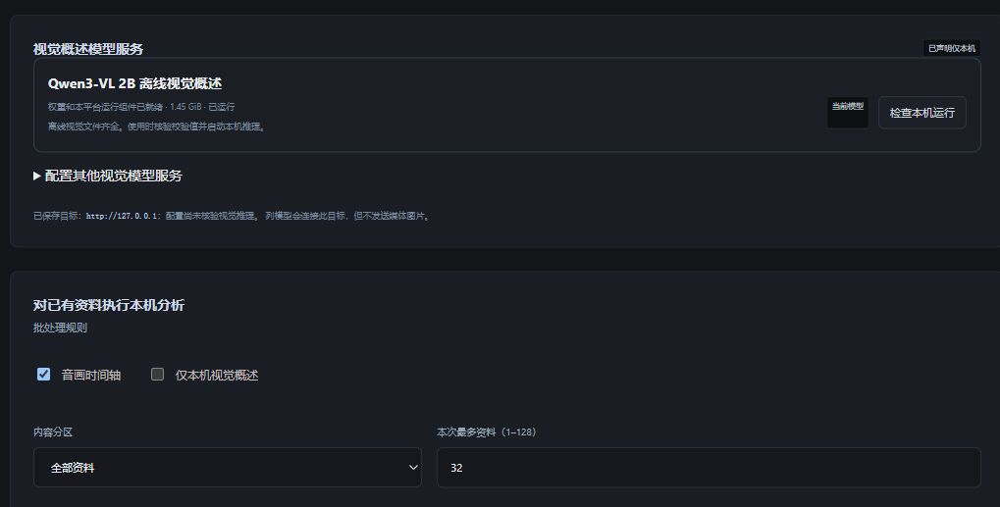
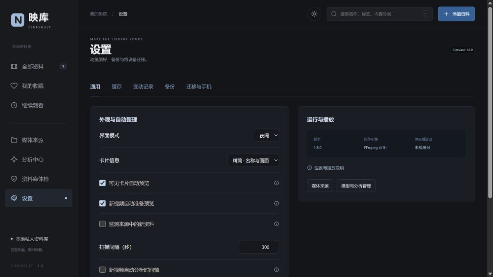
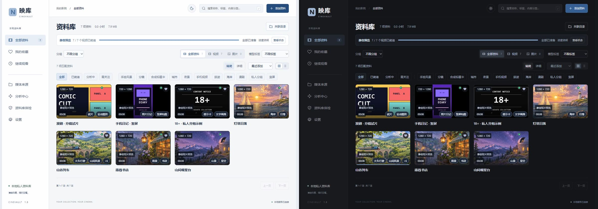

# 映库 · CineVault Local

[简体中文](README.md) · [Download the public preview](https://github.com/MNXOVZS/cinevault-local/releases) · [Report a bug or request a feature](https://github.com/MNXOVZS/cinevault-local/issues) · [MIT license](LICENSE)

**One private library for the videos you keep on your phone, computer, and external drives.**

Bring together exported iPhone and Android videos, short clips, anime and comic adaptations, old films, photos, and 18+ media you have the right to keep. Open CineVault Local to browse covers that come to life, filter by tags, and jump to the frame you remember. Your files stay where you put them.

## Browse, find, and watch

- **Previews play as you browse.** With card previews enabled, ready videos play muted while visible and pause when scrolled away. A green dot marks ready previews. Opening an item loads the player and starts playback when browser policy permits.
- **Find a frame without guessing.** Hover over or scrub the timeline for sampled thumbnails. Jump using scene changes, noticeable shifts in audio level, or your own markers. Play supported sources directly; FFmpeg can prepare a compatible playback copy when needed.
- **Keep private collections organized.** A dedicated 18+ section and searchable manual tags let you organize private videos and animation separately. Assign a section per item or choose a default for new items from a linked folder. Use favorites to return to the items you want to watch again.
- **Optionally let local AI suggest tags.** **Qwen3-VL 2B** can generate Chinese summaries and semantic tags from sampled frames, including scenes and clearly visible everyday actions such as walking, running, and waving. Results depend on the sampled frames. You can enable automatic analysis for new imports after installing the model. Model tags are searchable and stored separately from your manual classifications. The public preview does not integrate dedicated 18+ auto-classification or sexual-act recognition.
- **See what changed.** Preview folder scope and exclude subfolders before scanning. Linked folders are indexed read-only by default. Check for new or missing files and offline sources in the activity log; back up the catalogue, covers, and registered previews.

## Screenshots

The public gallery uses synthetic demo material. The black-and-white 18+ slate shows manual grouping. Qwen3-VL produced the train motion and bridge tags from two sampled frames of the train clip.

| Player and thumbnail scrubbing | Favorites |
| --- | --- |
|  |  |
| **Analysis Center** | **Settings** |
|  |  |

**Light and dark themes**

[See the activity log and item counts](docs/screenshots/activity.jpg)

## Run on Windows or macOS

1. Install **Python 3.11+** with SQLite and **FFmpeg** with `libx264`. Put both `ffmpeg` and `ffprobe` on your `PATH`. [Python downloads](https://www.python.org/downloads/) · [FFmpeg downloads](https://ffmpeg.org/download.html)
2. Download and extract the source. On Windows, open `Start-Windows.cmd` (or run `python -X utf8 launch.py`). On macOS, run `bash Start-Mac.command` from the project directory.
3. Open [the local app](http://127.0.0.1:8765) and choose **关联目录** to link a folder on your computer or a mounted drive. The current interface is in Simplified Chinese. The core app does not require an account or internet access.

The public preview includes launchers for both platforms. Startup, indexing, and playback were tested on Windows; testing on macOS hardware is pending. MOV, MKV, and AVI are among the containers the library can index. Whether playback works depends on the file's codecs and your FFmpeg build.

## External drives, migration, and offline use

**You choose what gets scanned.** The library can scan a linked folder recursively. When folder monitoring is enabled, the local service checks for additions periodically. A background queue prepares muted previews at up to 480 × 270 and 24 fps. Browsing reuses those small cached clips. The player picks direct playback, remuxing, or transcoding based on the source and browser support.

**Reconnect after a drive letter or mount location changes.** Stop the app, move the catalogue, cache, and backup as needed, mount the drive on the other computer, then choose and verify the new folder under source settings. Both computers need to be able to read the drive. The app does not silently change source paths or search other drives. Keep a separate backup of your originals.

To carry the catalogue with you, stop the app and run `python package_library.py --profile catalog --target universal` (use `python3` on macOS). The unencrypted ZIP contains the app, catalogue, covers, registered previews, and any model files installed in the app folder. Move or back up originals from external drives separately. Keep the archive private.

**AI can work offline too.** Run `python ai/setup_managed_vision.py` from the project directory, or use `python3` on macOS. Setup downloads about 1.45 GiB of model weights plus the native runtime. Choose Qwen3-VL in **分析中心** (Analysis Center). The installer offers Windows x64, Apple silicon, and Intel Mac runtimes. To search by image externally, review the frame and destination, then initiate the search in your browser.

## Feedback and credits

Search [GitHub Issues](https://github.com/MNXOVZS/cinevault-local/issues) or [open an issue](https://github.com/MNXOVZS/cinevault-local/issues/new/choose). Include your operating system, browser, FFmpeg version, file container and codecs, steps, and expected and actual behavior. Share redacted logs or synthetic samples instead of private media, covers, or file paths.

Thank you to the maintainers and contributors of [CPython](https://github.com/python/cpython), [SQLite](https://www.sqlite.org/), [FFmpeg](https://ffmpeg.org/), [TypeScript](https://github.com/microsoft/TypeScript), [esbuild](https://esbuild.github.io/), [Qwen3-VL](https://github.com/QwenLM/Qwen3-VL), and [llama.cpp](https://github.com/ggml-org/llama.cpp). [Pinned model weights](https://huggingface.co/Qwen/Qwen3-VL-2B-Instruct-GGUF/tree/52d6c8ffea26cc873ac5ad116f8631268d7eb503) · [Matching runtime release](https://github.com/ggml-org/llama.cpp/releases/tag/b12284)

Original code is provided under the [MIT license](LICENSE). Third-party components and models retain their upstream terms. Demo media is separate from the source license. [Public preview scope](docs/RELEASE-NOTES.md)
