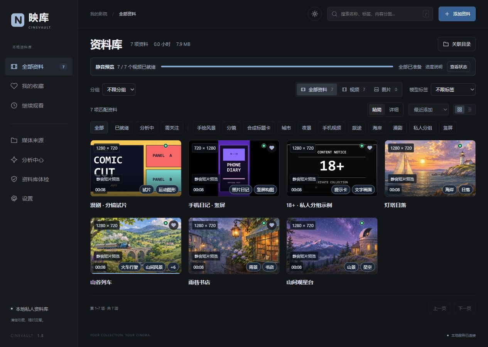
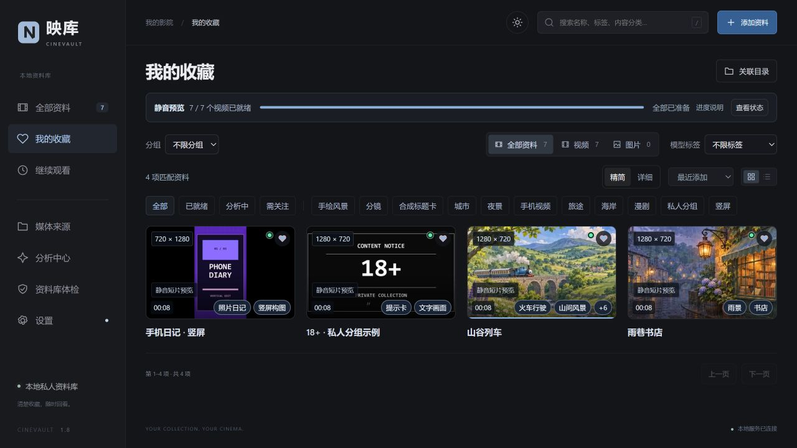
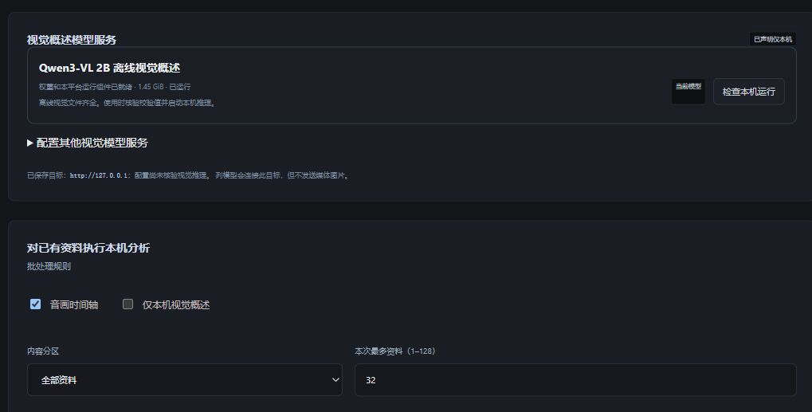
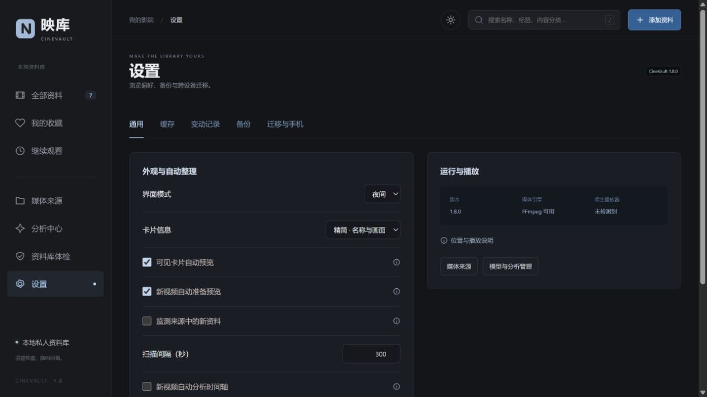
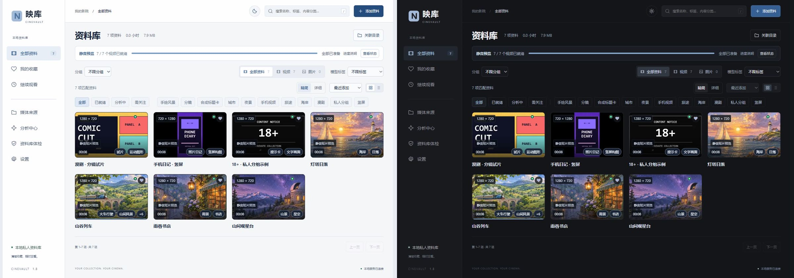

# 映库 · CineVault Local

[**在线体验**](https://mnxovzs.github.io/cinevault-local/demo/) · [**下载 Windows 版**](https://github.com/MNXOVZS/cinevault-local/releases/download/v1.8.1-preview/CineVault-Local-Windows-x64.zip) · [产品介绍](https://mnxovzs.github.io/cinevault-local/) · [English](README.en.md)

**不用搬原片，把外接硬盘里叫不出名字的视频变成一眼能找的影库。**

选一个目录，映库会在本机为视频建索引。卡片滚到眼前就能静音预览，点开后可以拖时间轴找画面。从手机导出的视频、动画、漫剧、电影、照片和 **18+ 视频**都可以一起归档，也可以分开浏览。

在线演示使用公开的非成人样片。点开就能搜、筛选、看预览和拖时间轴，无需安装或注册。要关联自己的硬盘，请使用本机版本。

## 看得快，找得准

- **打开就预览。** 开启卡片预览后，已就绪的可见卡片会自动静音播放，离屏后暂停。绿点表示预览就绪。打开影片即加载播放器，浏览器允许时自动开播。
- **拖着时间轴找画面。** 悬停或拖动时间轴可查看抽样缩略图。用画面切换、明显音量变化和手动标记跳到目标位置。片源可直接解码时直接播放，遇到须转换的编码再由 FFmpeg 生成兼容副本。
- **私人收藏由你分。** 用专门的 18+ 分区和可检索的手动标签整理 18+ 视频与动画。可在详情中调整分区，也可按目录指定新入库资料的分区。收藏、标题和标签都是回找入口。
- **可选离线 AI 自动打标签。** 安装 **Qwen3-VL 2B** 后，可从抽样画面生成中文概述，以及语义标签，包括场景和画面中清晰可见的普通动作，例如行走、跑步和挥手。结果取决于抽样画面。可开启新入库资料自动分析。模型标签与手动分类分别保存，可以筛选。公开预览版未集成专门的 18+ 自动分类或性动作识别。
- **扫描范围由你决定。** 预览指定目录的扫描范围，可排除子目录。默认只读索引，不搬移、改名或删除原片。设置里的变动记录可核对新增、缺失及来源离线情况，也可备份片目、封面和已登记的预览。

## 界面一览

公开截图均使用合成演示资料。黑白 18+ 提示卡演示手动分区。列车短片的「火车行驶」「古桥」是 Qwen3-VL 从两张抽样图生成的标签。

| 播放器和时间轴 | 我的收藏 |
| --- | --- |
|  |  |
| **分析中心** | **设置** |
|  |  |

**日间 / 夜间主题对比**

[查看变动记录与数量核对](docs/screenshots/activity.jpg)

## Windows 便携试用

1. [下载 Windows x64 试用包](https://github.com/MNXOVZS/cinevault-local/releases/download/v1.8.1-preview/CineVault-Local-Windows-x64.zip)，完整解压到一个你有写入权限的文件夹。
2. 双击 `Start-Trial.cmd`。在本机浏览器中点「体验样片」，无需联网即可播放随包的非成人短片。
3. 整理自己的资料时，点「关联目录」和「选择文件夹」，在系统窗口选择本机或外接硬盘的目录。确认扫描范围后，映库会原位建立索引。

自己文件的封面、静音预览与兼容转换需要 FFmpeg。如果电脑尚未安装，可双击包内的 `Setup-FFmpeg.cmd`，确认后从上游下载并安装到试用目录。试用包自带 Python。详情见[发行说明](https://github.com/MNXOVZS/cinevault-local/releases/tag/v1.8.1-preview)。

## macOS 与源码运行

源码版需要带 SQLite 的 **Python 3.11+**，以及带 `libx264` 的 **FFmpeg** 和 `ffprobe`。下载并解压源码，在 Windows 双击 `Start-Windows.cmd`。在 Mac 的终端中进入目录，运行 `bash Start-Mac.command`。Mac 实机验证待完成。[源码与发行说明](https://github.com/MNXOVZS/cinevault-local/releases/tag/v1.8.1-preview) · [Python](https://www.python.org/downloads/) · [FFmpeg](https://ffmpeg.org/download.html)

MOV、MKV、AVI 都可进入扫描范围。能否直放或生成兼容副本取决于视频编码和本机 FFmpeg。

## 外接硬盘、迁移与离线使用

**扫描只发生在你关联的范围内。** 映库可递归扫描该目录及子目录；开启目录监测后，本机服务运行期间会定期检查新增。预览由后台队列生成，使用最高 480 × 270、24 fps 的静音短片。浏览时复用预览缓存，避免为每张卡片反复解码大文件。播放器会按原片与浏览器支持情况选择直放、换封装或转码。

**硬盘换盘符或从 Windows 拔到 Mac 时，重新关联即可。** 先停映库并迁移片目、缓存和备份，再挂载硬盘，在来源设置选新位置并核对。硬盘须能被两台电脑读到。来源原路径不会被静默改写，换位置不代表自动搜遍所有磁盘。原片需要单独备份。

要把片目一起带走，停服务后运行 `python package_library.py --profile catalog --target universal`（macOS 使用 `python3`）。压缩包包含程序、片目、封面和已登记预览，也会带上已安装在程序目录里的模型文件。外接盘原片需另外迁移。压缩包未加密，请按私人资料保管。

**AI 也可留在本机。** 在项目目录运行 `python ai/setup_managed_vision.py`；macOS 可用 `python3`。脚本下载约 1.45 GiB 的模型权重及本机推理组件。下载后在「分析中心」选择 Qwen3-VL，即可离线分析。模型安装器提供 Windows x64、Apple 芯片与 Intel Mac 的运行组件。外部搜图由你核对截图和目标后，交给浏览器手动发起。

## 反馈与开源致谢

在 [GitHub Issues](https://github.com/MNXOVZS/cinevault-local/issues) 查找已有问题，或[新建反馈](https://github.com/MNXOVZS/cinevault-local/issues/new/choose)。报告播放、预览或硬盘重连问题时，请写上系统、浏览器、FFmpeg 版本、文件封装及编解码器、复现步骤、预期结果和实际现象。请用脱敏日志或合成样片，避免上传私人视频、封面和磁盘路径。

感谢 [CPython](https://github.com/python/cpython)、[SQLite](https://www.sqlite.org/)、[FFmpeg](https://ffmpeg.org/)、[TypeScript](https://github.com/microsoft/TypeScript)、[esbuild](https://esbuild.github.io/)、[Qwen3-VL](https://github.com/QwenLM/Qwen3-VL) 和 [llama.cpp](https://github.com/ggml-org/llama.cpp) 的维护者与贡献者。[固定模型权重](https://huggingface.co/Qwen/Qwen3-VL-2B-Instruct-GGUF/tree/52d6c8ffea26cc873ac5ad116f8631268d7eb503) · [对应推理组件](https://github.com/ggml-org/llama.cpp/releases/tag/b12284)

原创源码采用 [MIT 许可证](LICENSE)。第三方组件和模型沿用上游许可；演示素材独立于源码授权。[公开预览范围](docs/RELEASE-NOTES.md)
